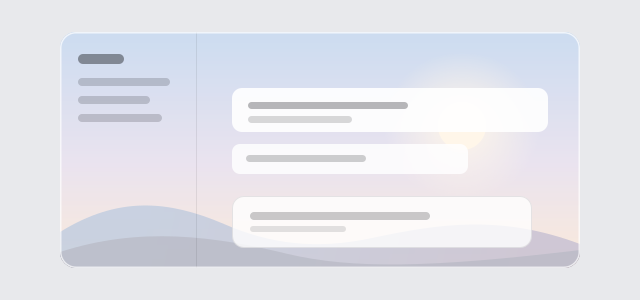

# DSH 背景图片插件

给 DeepSeek Harness（DSH）的 Web 界面换一张整窗背景图：图片铺在整个窗口后面，再盖一层跟随主题的底色，面板半透明透出背景，同时保证文字可读。

<p>
  
</p>



## 功能

- **整窗背景**：一张图片铺满整个窗口，聊天区、侧栏、空白会话页透出程度一致。
- **可调外观**：背景强度 0–80%（默认 25%），模糊 0–48px（默认 16px）。强度超过 45% 会提示小号文字可能不易阅读。
- **跟随主题**：底色从当前主题的实际颜色解析，浅色/深色及自定义主题切换时自动更新。
- **可读性优先**：输入框保持磨砂质感，卡片、菜单、设置面板保持实色，避免文字压在图上看不清。
- **只存本机**：图片在页面内压缩后保存在浏览器本地，插件不发起任何网络请求，也不会上传图片。
- **随时恢复**：移除图片或禁用插件即可回到默认外观。

## 安装

插件以本地目录形式安装，不需要构建：

```bash
git clone https://github.com/baicheng2333/dsh-background.git
```

打开 DSH → **设置 → 插件 → 添加插件**，选择克隆下来的 `dsh-background` 目录即可。装好后在 **设置 → 背景** 里选择图片。

> 需要 DSH 桌面版或 Web 版，且已启用设置与主题相关插件（默认组合都满足）。

## 使用

1. 打开 **设置 → 背景**。
2. 点 **选择图片**，或把图片文件拖进这一页。
3. 调整 **背景强度** 和 **模糊**，效果即时生效。
4. 点 **移除** 清除图片；设置里也有 **恢复默认外观**。

图片处理规则：长边压缩到 2000px 以内，优先编码为 WebP（不支持时回退 JPEG），编码后超过约 2.2M 字符会被拒绝。数据保存在 `localStorage` 的 `dsh.background.settings.v1` 与 `dsh.background.image.v1` 两个键下。

## 实现要点

- DSH 会在不同区域重复绘制窗口底色 token（例如会话根节点再叠一层），逐层调透明度会让聊天区和普通页面深浅不一。因此这里只画**一层**整窗遮罩，并把底色/侧栏 token 置为透明，让所有区域透出程度一致。
- 遮罩与输入框的颜色按当前主题的 `--dsw-*` token 实时解析，切换主题或注册主题时重建。
- 浏览器半（`client.js`）是手写 CommonJS 模块，无构建步骤；宿主半（`index.js`）只负责让 Loader 条目存在。

## 目录

```
client.js          浏览器半：背景层、遮罩、设置页、图片压缩与本地存储
index.js           宿主半（空实现，仅激活包）
cordis.patch.yml   DSH Loader 补丁
package.json       包清单与 dsh.client / dsh.bundle 声明
locale/            插件管理器的标题、描述与详情页
docs/              详情页文档与示意图
icon.png           插件图标
```

修改代码后，在插件管理里停用再启用插件，或刷新页面即可加载新版本。

## 隐私

插件不发送网络请求。你选择的图片只保存在当前浏览器的本地存储里（桌面版为 `dsh-app://app` 源），不会写入 DSH 配置目录，也不会进入会话记录。

## 许可证

代码使用 [MIT 许可证](LICENSE)。
`icon.png` 为作者提供的插画素材，不随 MIT 许可证授权。

---

## English summary

A DSH Web GUI plugin that puts a picture behind the whole window under a theme-colored wash, with a tunable strength/blur, a frosted composer, and solid cards for readability. The picture is downscaled in the page and stored in the browser only; the plugin makes no network requests.

Install: clone this repo, then **Settings → Plugins → Add plugin** and pick the directory. Use it in **Settings → Background**.

Code is MIT-licensed; the icon artwork is supplied by the repository owner and is not covered by the MIT license.
